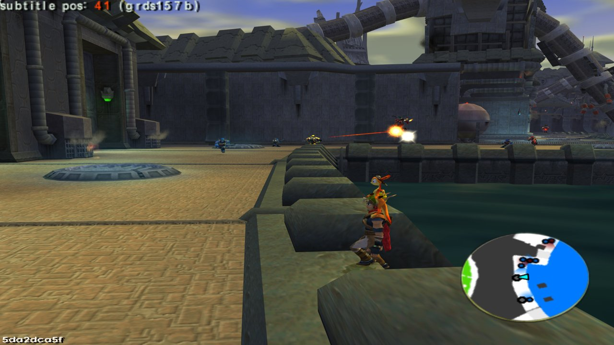
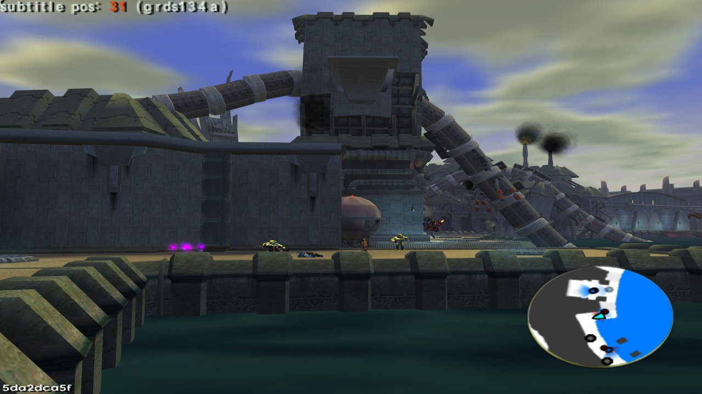
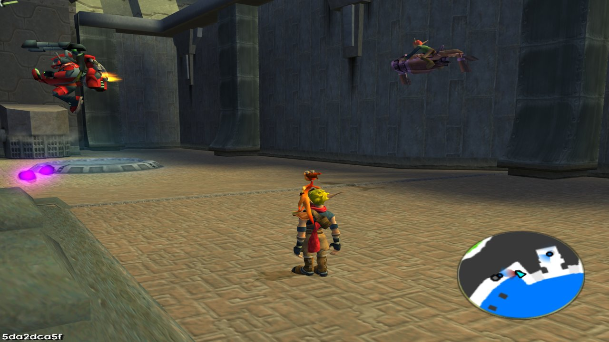

# Praxis KG Invasion — Jak 3

<p align="center">
  
  
  
</p>

> **Contents:** [Overview](#overview) · [Key Features](#key-features) · [How to Play](#how-to-play) · [Developer Setup](#developer-setup--local-compilation) · [Technical Documentation](#technical-documentation)

---

## Overview
Jak 2's Krimzon Guard invades Jak 3's Haven City. Red and yellow Krimzon Guards, backed by red
jetpack guards, fight the Freedom League's blue guards street by street, in the districts you pick.

- **Target Game:** Jak 3
- **Repository:** [`whozghiar/jak3-mod-praxis-kg-invasion`](https://github.com/whozghiar/jak3-mod-praxis-kg-invasion), created from the modding base [`whozghiar/jak-project`](https://github.com/whozghiar/jak-project)



## Key Features
- **Two armies in the streets:** Jak 2's red Krimzon Guards (rifle or grenade launcher) and yellow
  dark guards against the Freedom League, which fight each other on sight.
- **Red jetpack guards** fly over the conflict zones.
- **Pick the battlefield:** every district of the city by default, or only the ones you tick
  (port, industrial section, slums, Metal Head city...).
- **The citizens flee**, the Krimzon Guards shoot at Jak too, and the fights play the music of the
  Krimzon Guard's attack on the port.
- **Off by default:** the game is unchanged until you switch the invasion on. A Jak 3 mission in the
  city keeps the city as the mission wants it; the invasion comes back when it ends.





## How to Play
1. Open the Mods menu: **L3 + SELECT**.
2. Go to **Praxis KG Invasion** and tick **Invasion on (Jak 3's city)**.
3. Optional: in **Conflict zones**, untick the districts you want to keep peaceful (**Whole city**
   ticks or unticks them all).
4. Walk into Haven City.

The switch is off again at every boot.

---

## Developer Setup & Local Compilation

### 0. Get the Source
Already working in a clone of [`whozghiar/jak-project`](https://github.com/whozghiar/jak-project)? Switch to this mod there, keeping your extracted game data:
```bash
task modding-switch -- jak3-mod-praxis-kg-invasion
```
Otherwise clone it on its own; the knowledge base used by AI agents is a submodule, so clone with it:
```bash
git clone --recurse-submodules https://github.com/whozghiar/jak3-mod-praxis-kg-invasion.git
```

### 1. Select the Active Game
```bash
task set-game-jak3
```

### 2. Binary Compilation
- **Status:** not required (GOAL-only mod, standard binaries).

### 3. Models and Asset Extraction
- **Status:** required. The Krimzon Guard models are made from your own Jak 2 and Jak 3
  extractions (with `rip_levels` on for both games), then baked into Jak 3's city levels:
```bash
python scripts/praxis_kg_invasion/make_models.py
task extract
```

### 4. Launch the Game
```bash
task boot-game
```
*(Or launch via the OpenGOAL REPL using `task repl`, then compile and run with `(mi)` and `(r)`).*

## Technical Documentation
For the technical breakdown, architecture and developer notes, refer to:
- [`docs/modding/current_mod/praxis_kg_invasion_readme.md`](docs/modding/current_mod/praxis_kg_invasion_readme.md)

---
*(AI-assisted)*
